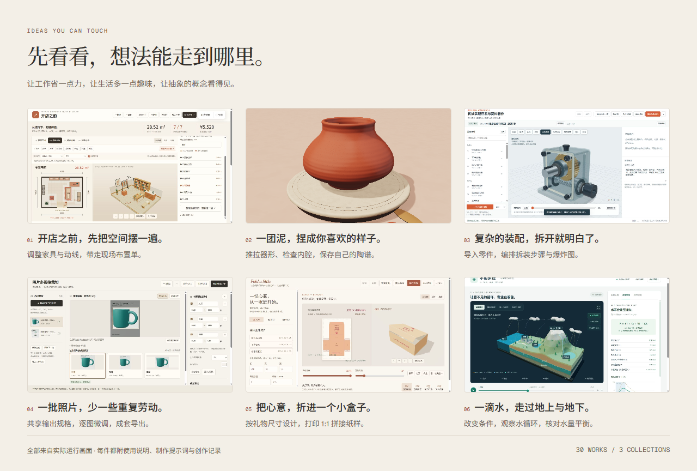

<p align="center">
  <a href="https://hyyhf.github.io/imagination-atelier/"></a>
</p>

<p align="center">
  <a href="https://hyyhf.github.io/imagination-atelier/">在线体验</a> ·
  <a href="#安装">安装 Skill</a> ·
  <a href="#使用">开始创作</a> ·
  <a href="https://hyyhf.github.io/imagination-atelier/downloads/imagination-atelier-creative-kit.zip">下载创作工具包</a>
</p>

**想象显影机是给 AI Agent 用的作品创作 Skill。** 从一句愿望、一张参考图、手边的材料，或一个工作中的麻烦开始，让 AI 把想法做成可以在本地打开的 HTML 作品。工具、三维设计、教学实验、游戏与互动叙事，都可以成为它的形式。

你说想做什么，它来推导怎么做。做出来之后，还要能带入自己的内容、调整细节、带走成果，继续完成下一件。

## 先看看能做什么

<p align="center">
  <a href="https://hyyhf.github.io/imagination-atelier/"></a>
</p>

| 想做的事 | 直接体验 |
| --- | --- |
| **布置空间与设计器物** | [店铺空间布置](https://hyyhf.github.io/imagination-atelier/works/11-popup/index.html) · [陶器 3D](https://hyyhf.github.io/imagination-atelier/works/04-pottery/index.html) · [机械装配](https://hyyhf.github.io/imagination-atelier/works/01-assembly/index.html) |
| **少做一些重复工作** | [照片批量裁切](https://hyyhf.github.io/imagination-atelier/works/03-photo-batch/index.html) · [CSV 清洗](https://hyyhf.github.io/imagination-atelier/works/08-csv-cleaner/index.html) · [订单排程](https://hyyhf.github.io/imagination-atelier/works/02-production/index.html) |
| **做点生活里的小作品** | [礼盒纸样](https://hyyhf.github.io/imagination-atelier/works/12-packaging/index.html) · [阳台种植](https://hyyhf.github.io/imagination-atelier/works/14-garden/index.html) · [本地音频剪辑](https://hyyhf.github.io/imagination-atelier/works/20-audio/index.html) |
| **让概念变得看得见** | [水循环沙盘](https://hyyhf.github.io/imagination-atelier/works/25-water-cycle/index.html) · [电路仿真](https://hyyhf.github.io/imagination-atelier/works/24-circuit/index.html) · [数据拟合](https://hyyhf.github.io/imagination-atelier/works/21-fit/index.html) |

仓库里有 **30 件可体验的作品**，每件附使用说明、独立制作提示词和创作记录。[查看完整目录 →](docs/EXAMPLES.md)

这些作品展示的是可能性。你的题目不必在目录里，也不必先有一个完整方案。

## 它怎么把想法变成作品

1. **先弄清楚，你真正想完成什么。** 不需要写技术规格。说说手边有什么、哪里麻烦、最后想得到什么，就能开始。
2. **找到最值得改变的那一步。** 一批照片不必逐张设尺寸，一份表格不必每周重新整理。它先找重复劳动和难以判断的地方，再设计更直接的操作。
3. **让形式跟着内容走。** 尺寸和装配可以用三维，文字可以并排校对，声音可以放进时间线。题目决定作品长什么样。
4. **让你的材料真的用得上。** 需要导入模型、照片、表格或音频时，把入口做出来；预览、修改和导出连在一起，最后留下能继续使用的成果。
5. **做完这一件，还能很快开始下一件。** 保留有用的规则、设置和方案，换一份材料再试。完成度看实际操作和输出，也看下次是否还愿意打开它。

## 安装

把这句话交给支持安装 Skill 的助手：

```text
请帮我安装想象显影机的 imagination-developer Skill：
https://github.com/hyyhf/imagination-atelier
安装 skills/imagination-developer 完整目录。
```

或者在装有 Node.js 的终端中运行：

```bash
npx skills add hyyhf/imagination-atelier --skill imagination-developer
```

装好后，点名使用 `imagination-developer` 即可。没有 Skill 安装入口也能用：在[创作工作台](https://hyyhf.github.io/imagination-atelier/#skill)写下想法，复制完整指令，交给你使用的 AI。

<details>
<summary>手动安装、全局安装与普通聊天</summary>

- **手动安装：** 复制整个 [skills/imagination-developer](skills/imagination-developer/SKILL.md) 目录，保留 `SKILL.md`、`references` 和 `agents`，放到助手支持的技能目录。
- **跨项目使用：** 在安装命令末尾加上 `--global`；可用目标以 [Skills CLI](https://github.com/vercel-labs/skills) 的提示为准。
- **普通聊天：** 复制[完整元提示词](prompts/full-meta-prompt.txt)，在末尾追加自己的需求，一起发送给 AI。
- **带到本地：** 下载[创作工具包](https://hyyhf.github.io/imagination-atelier/downloads/imagination-atelier-creative-kit.zip)，解压后打开 `START.html`，填写想法并复制完整指令。

[查看安装说明 →](docs/INSTALL.md)

</details>

## 使用

直接告诉助手你想做什么。例如：

- **给工作做个顺手的工具：**「用 imagination-developer 做一个报名表整理工具。我每周收到几个渠道的表格，想统一日期、去重，看到有问题的记录并修改；下周换一批文件，还能用同一套规则。」
- **把空间里的想法试出来：**「我准备开一家小店。用 imagination-developer 做一个布置工具，让我输入房间尺寸、摆放家具、检查入口通路，最后带走现场布置单。」
- **把回忆做成一份礼物：**「用 imagination-developer 把奶奶的故事、照片和声音做成可以慢慢翻看的作品。先给我三个体验不同的方向，说说我还需要准备哪些材料。」
- **让抽象的知识可以动手：**「用 imagination-developer 做一个反射光路实验，让学生移动镜子，看到光线变化，自己找到把光送到目标的方法。」
- **继续改进已有作品：**「用 imagination-developer 改这个作品，让我能导入自己的内容；修改预览后，导出的文件也要保持一致。」

图片、模型、表格、声音、文字和现成项目都可以一起提供。还没想清楚时，可以先找方向；明确说「做一个」「实现」「完善」，就默认交付成品。只想要制作提示词时，直接说清楚即可。

默认交付一个或少量 HTML 文件，按需附本地资源。使用成品通常只需在浏览器打开，无需安装项目依赖；具体输入格式、运行条件和验证范围见作品说明。

## 喜欢的话，就带走吧

| 想带走什么 | 下载 |
| --- | --- |
| **先试试完整作品集** · 30 件作品和使用说明，解压后打开 `START.html` | [全部作品 ZIP](https://hyyhf.github.io/imagination-atelier/downloads/atelier-all-30.zip) |
| **开始自己的创作** · 完整 Skill、元提示词和本地创作入口 | [创作工具包 ZIP](https://hyyhf.github.io/imagination-atelier/downloads/imagination-atelier-creative-kit.zip) |
| **研究、修改或继续做** · React 网站、独立作品和创作资料 | [完整源码 ZIP](https://hyyhf.github.io/imagination-atelier/downloads/portfolio-source.zip) |

## 关于这套 Skill

它把制作重心放在「怎么更直接地完成一件事」：选对对象的表达方式，让关键操作、预览和最终输出保持一致，并考虑如何连续使用。生成效果仍取决于执行模型、素材与任务约束。

我们保留了[同题对比记录](docs/SKILL_EVALUATION.md)，把直接让 AI 制作与使用 Skill 的结果放在同一需求下比较，也记录实际输出和尚未验证的部分。你可以先体验作品，再判断这套方法是否适合自己的题目。

<details>
<summary>开发网站与参与贡献</summary>

网站使用 React、HeroUI、Lucide 与 GSAP。需要 Node.js 22 和 Python 3；作品的使用者无需准备开发环境。

```bash
npm ci
npm run dev
```

制作新的独立作品、改善现有任务流程，或补充更清楚的验证证据，都欢迎参与。[贡献说明](CONTRIBUTING.md) · [阅读 Skill](skills/imagination-developer/SKILL.md) · [反馈问题](https://github.com/hyyhf/imagination-atelier/issues)

</details>

## 许可

原创代码、Skill 与文档采用 [MIT License](LICENSE)。第三方库、字体和素材保留各自许可，见 [THIRD_PARTY_NOTICES.md](THIRD_PARTY_NOTICES.md)。
