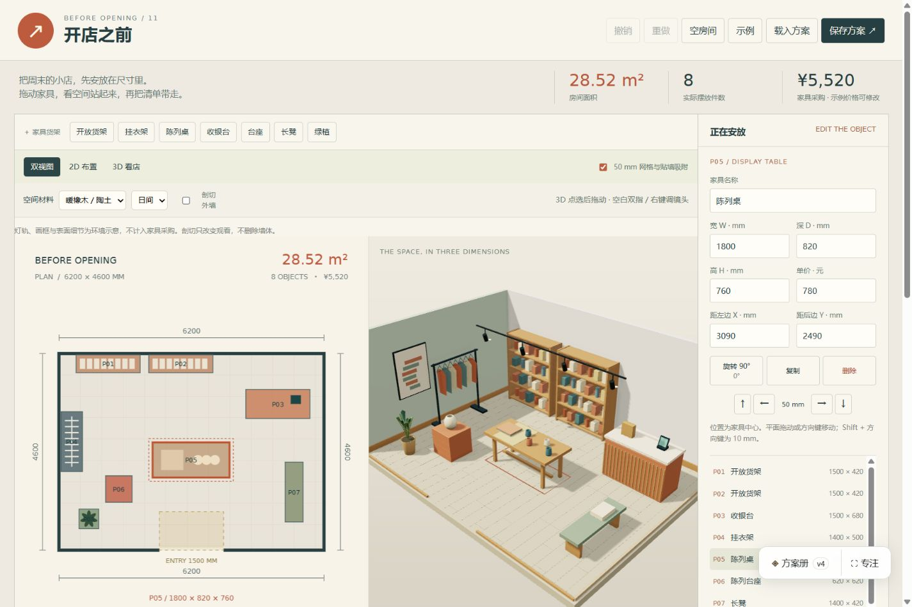
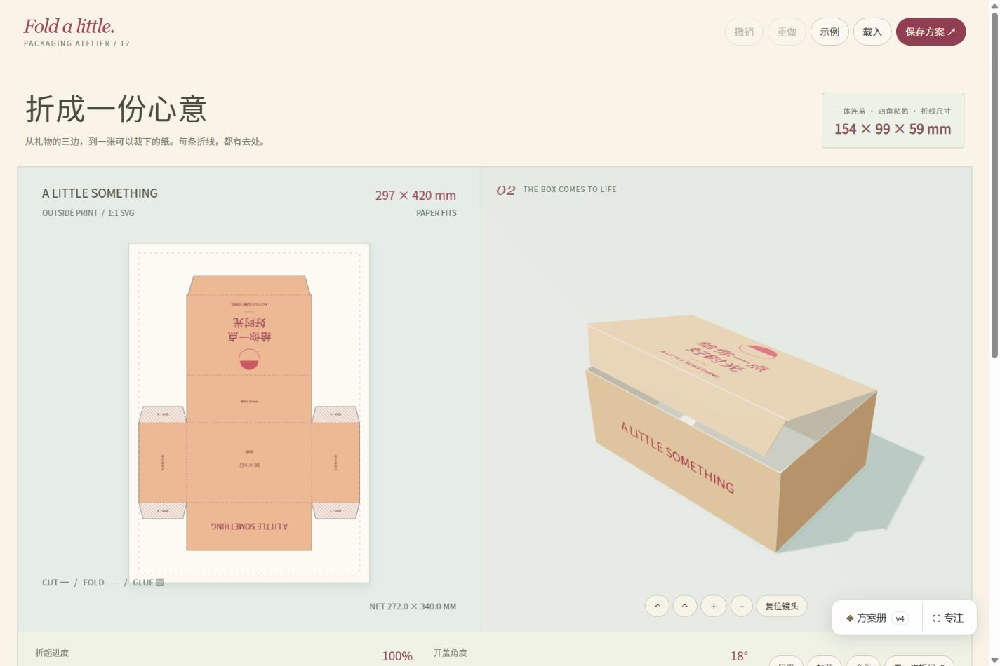
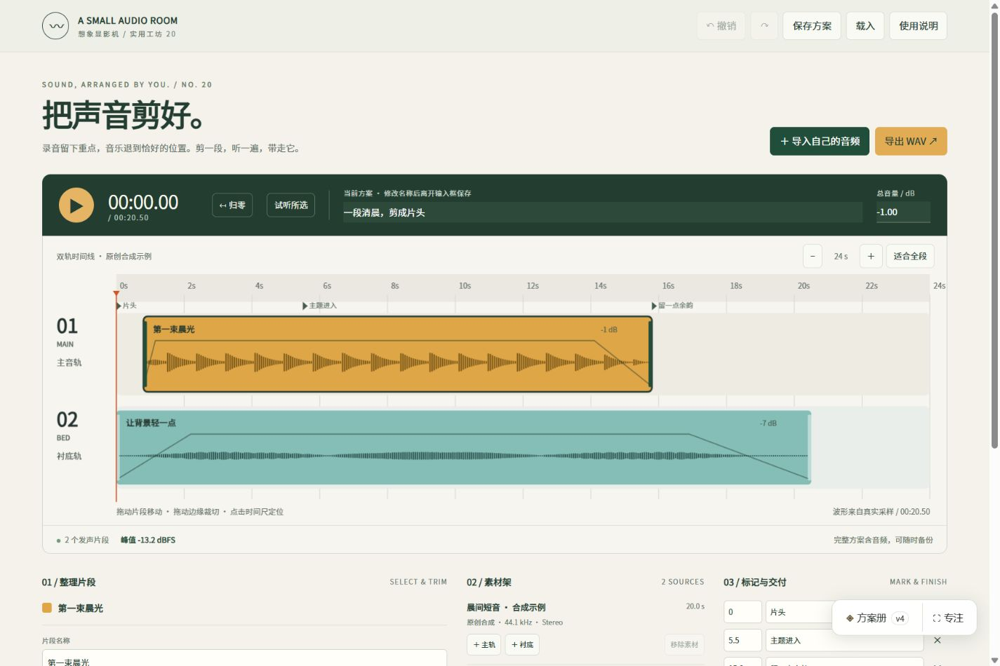
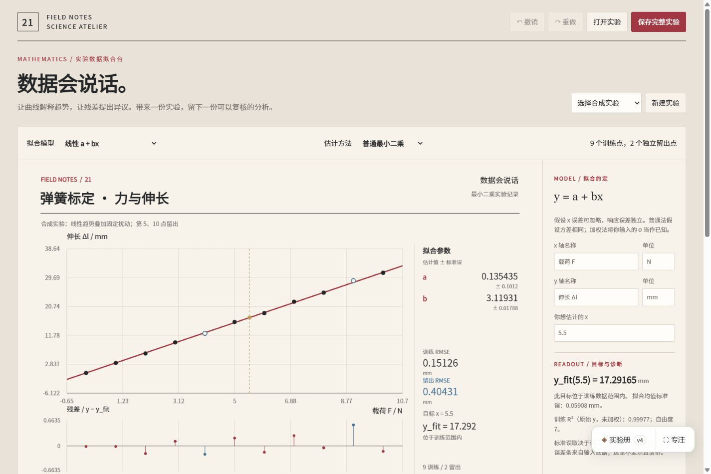
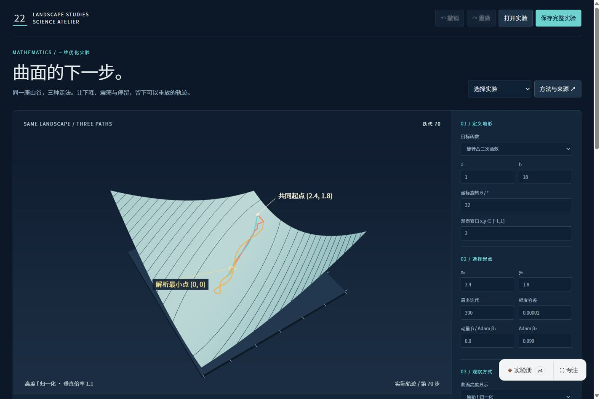

# 想象显影机 · Imagination Atelier

**把一个想法，做成可以亲手使用的作品。**

想象显影机是面向 AI Agent 的创作 Skill，调用名为 `imagination-developer`。它帮助 AI 把模糊的愿望、参考图片或已有素材，发展为具体的制作方案，并进一步实现可在浏览器中使用的工具、实验、教学演示、故事与艺术作品。

它把需求梳理、内容组织、视觉设计、交互逻辑和文件交付连接起来：明确用户要完成什么，选择合适的表达方式，让输入、操作和结果形成一段完整体验。你可以先探索方向、只生成制作提示词，也可以直接要求交付成品。

[体验 30 件作品](https://hyyhf.github.io/imagination-atelier/) · [安装 Skill](#安装) · [使用方法](#使用) · [阅读 Skill](skills/imagination-developer/SKILL.md)

## 作品效果

仓库收录 30 件独立 HTML 作品，涵盖空间设计、日常工具、科学实验与创意表达。下面是其中 6 件作品的真实浏览器截图；点击图片可查看原图，点击「体验作品」可直接操作。

<table>
<tr>
<td width="50%">
<a href="docs/screenshots/11-popup.png"></a>
<strong>开店之前 · 空间布置</strong><br>
按真实尺寸摆放家具，同时查看平面占地和三维空间，汇总采购清单并保存方案。<br>
<a href="https://hyyhf.github.io/imagination-atelier/works/11-popup/index.html">体验作品 ↗</a>
</td>
<td width="50%">
<a href="docs/screenshots/12-packaging.png"></a>
<strong>折成一份心意 · 包装设计</strong><br>
输入礼物尺寸，编辑文字与图案，观察礼盒折起效果，导出带毫米尺寸的 SVG 纸样。<br>
<a href="https://hyyhf.github.io/imagination-atelier/works/12-packaging/index.html">体验作品 ↗</a>
</td>
</tr>
<tr>
<td width="50%">
<a href="docs/screenshots/20-audio.png"></a>
<strong>把声音剪好 · 音频编辑</strong><br>
导入音频，在双轨时间线上裁切、分割、移动和淡化片段，导出 WAV 与可恢复的方案。<br>
<a href="https://hyyhf.github.io/imagination-atelier/works/20-audio/index.html">体验作品 ↗</a>
</td>
<td width="50%">
<a href="docs/screenshots/21-fit.png"></a>
<strong>数据会说话 · 数据分析</strong><br>
导入 CSV，比较拟合模型、残差与留出误差，把实验条件、图表和结果一起带走。<br>
<a href="https://hyyhf.github.io/imagination-atelier/works/21-fit/index.html">体验作品 ↗</a>
</td>
</tr>
<tr>
<td width="50%">
<a href="docs/screenshots/22-optimization.png"></a>
<strong>曲面的下一步 · 数学实验</strong><br>
调整起点与学习率，在同一曲面上比较梯度下降、动量与 Adam，回放并导出迭代轨迹。<br>
<a href="https://hyyhf.github.io/imagination-atelier/works/22-optimization/index.html">体验作品 ↗</a>
</td>
<td width="50%">
<a href="docs/screenshots/30-rag.png"></a>
<strong>答案之前，先找证据 · 检索实验</strong><br>
导入自己的资料，比较 BM25 与 TF-IDF，标注相关性，导出带来源的证据包和评测报告。<br>
<a href="https://hyyhf.github.io/imagination-atelier/works/30-rag/index.html">体验作品 ↗</a>
</td>
</tr>
</table>

更多作品包括日光观察、陶艺塑形、交通配时、字体海报、备餐排程和镜头预演。每件作品附有制作提示词与使用说明，可在[在线展厅](https://hyyhf.github.io/imagination-atelier/)查看，也可下载 HTML 到本地使用。

## 它如何工作

1. **把愿望变成具体任务。** 从「我想做个小工具」出发，明确谁会使用、带入什么内容、完成什么操作，以及最后需要留下什么成果。
2. **为题目选择表达方式。** 空间关系用三维，数据规律用图表，时间与声音用时间线，阅读与叙事用适合内容的组织方式。版式、材质、文字和反馈围绕题目决定。
3. **让内容、操作与结果连起来。** 用同一份数据驱动画面、数值和导出，考虑连续修改、撤销、保存与恢复，让作品能够接受用户自己的内容。
4. **检查实际交付。** 打开最终文件，核对画面、关键操作与输出；根据任务检查窄屏、异常输入和离线使用，并说明必要的使用范围。

适合把教学知识做成可操作的实验，把生活或工作中的小需求做成工具，也适合从参考材料出发创作有独立表达的互动作品。

## 安装

### 使用安装命令

在装有 Node.js 的终端中运行：

```bash
npx skills add hyyhf/imagination-atelier --skill imagination-developer
```

通过 [Skills CLI](https://github.com/vercel-labs/skills) 安装到当前项目，支持的助手包括 Codex、Claude Code 和 Cursor。如需在多个项目中使用，可在命令末尾加上 `--global`。

### 让 Agent 安装

把下面这段话交给支持安装 Skills 的助手：

```text
请帮我安装 imagination-developer Skill：
https://github.com/hyyhf/imagination-atelier
Skill 位于 skills/imagination-developer，请安装完整目录。
```

手动安装时，从仓库复制整个 [skills/imagination-developer](skills/imagination-developer) 文件夹到助手的技能目录，保留其中的 `SKILL.md`、`references`、`assets` 和 `scripts`。

### 普通聊天中使用

不支持 Skills 的助手也可以使用：复制[完整创作提示词](prompts/full-meta-prompt.txt)，在末尾追加你的需求，然后一起发送给 AI。

## 使用

安装后，在任务中点名使用 `imagination-developer`，并说明想要方向、提示词还是成品。

### 还没有明确方向

```text
使用 imagination-developer。我想让中学生通过亲手操作理解光的反射，
请提出三个不同的互动作品方向，说明每个方向中学生会做什么、看到什么。
```

### 先生成制作提示词

```text
使用 imagination-developer。我想做一个小展览布置工具：
输入展厅和展品尺寸，尝试摆放，检查遮挡，最后导出布置图。
请把这个想法写成可以交给另一个 AI 独立执行的完整制作提示词。
```

### 直接制作作品

```text
使用 imagination-developer，直接制作一个可本地打开的礼盒设计工具。
我希望输入礼物尺寸、修改文字和颜色、查看折起效果，并导出 SVG 纸样。
请交付完整 HTML 文件和简短使用说明。
```

有参考截图、数据、文案或现成项目时，可以一并提供。已有作品也可以要求继续改进，例如「让布置图和采购清单随家具修改同步更新，补上保存与恢复」。

只要求制作提示词时，得到的是包含内容、视觉、交互和验收要求的完整指令；明确要求制作时，得到的是实际作品文件。默认交付目标是一个或少量可在本地浏览器中打开的 HTML 文件，按任务提供图像、SVG、CSV、JSON 或音频等成果。

## 许可

原创代码、Skill 和文档采用 [MIT License](LICENSE)。作品中使用的第三方资源保留各自许可，详见 [THIRD_PARTY_NOTICES.md](THIRD_PARTY_NOTICES.md)。
