# 案例画廊｜26 幅实际渲染记录

[回到 README](../README.md) · [30 件案例目录](EXAMPLES.md)

这里展示归档中的同源场景渲染与 Canvas／图面导出，不是浏览器整页截图。未补绘界面、未更改图中数据。缩略展示图等比缩放并转为 JPEG，原图来源、尺寸与 SHA-256 见 [provenance.json](images/provenance.json)。

17–20 号案例的图像证据在本次可恢复附件中缺失，故不展示替代图；它们的应用 HTML、提示词和说明均完整保留。

## 形式探索
<table>
<tr>
<td width="50%"><a href="images/01-lightroom.jpg">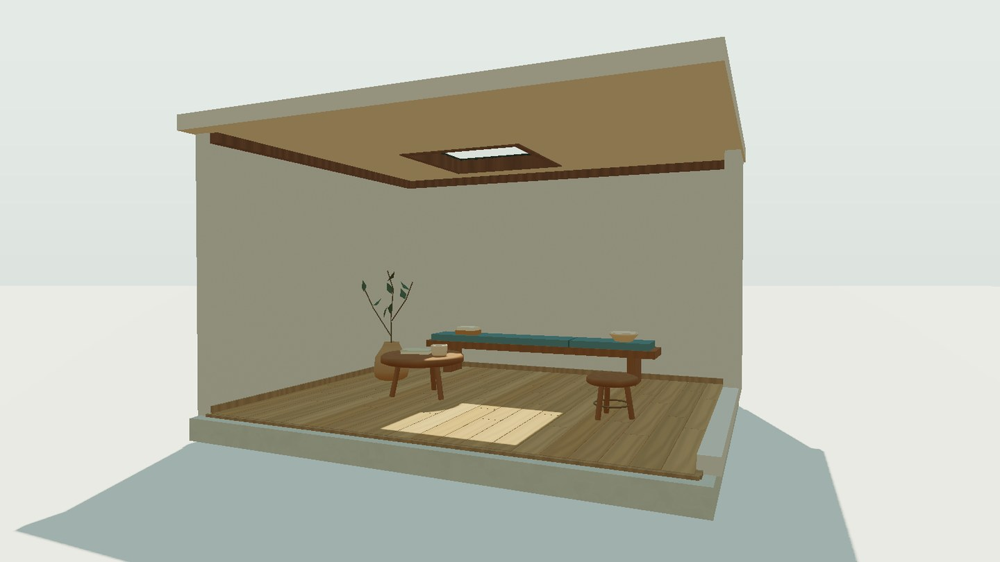</a> <strong>01 · 光在小屋里</strong> 改变真实天窗开口，观察同一房间内的光与阴影。 <a href="../public/works/01-lightroom/index.html">应用源文件</a> · <a href="../public/works/01-lightroom/readme.txt">使用说明</a></td>
<td width="50%"><a href="images/02-differential.jpg">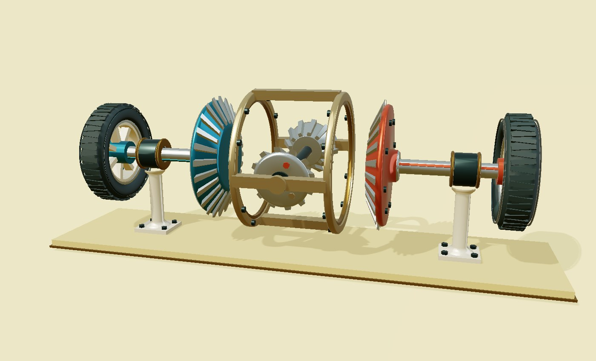</a> <strong>02 · 弯路，留一点余地</strong> 改变转弯强度，拆开观察差速器的传动关系。 <a href="../public/works/02-differential/index.html">应用源文件</a> · <a href="../public/works/02-differential/readme.txt">使用说明</a></td>
</tr>
<tr>
<td width="50%"><a href="images/03-strata.jpg">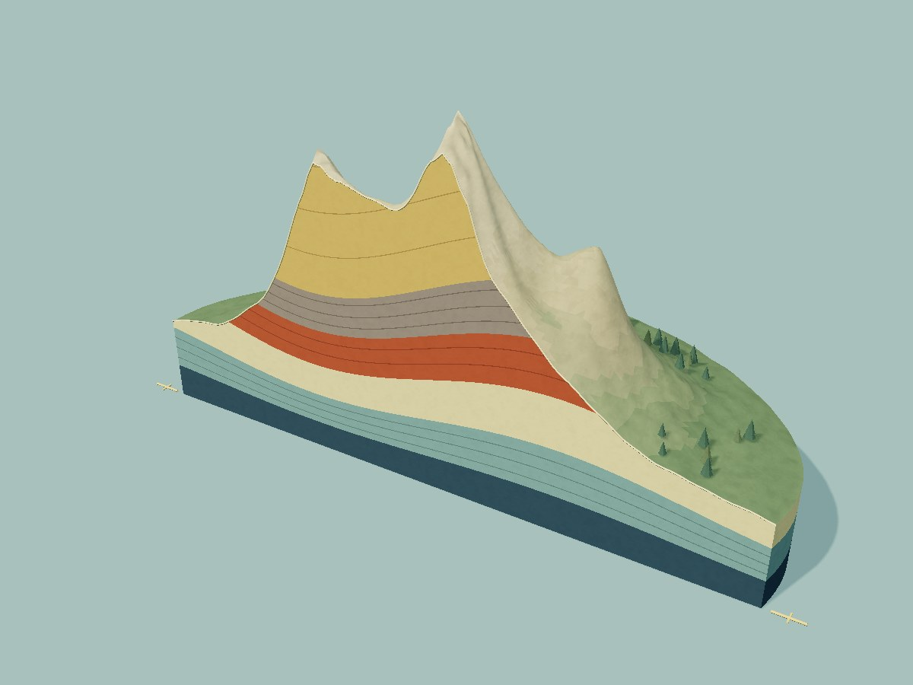</a> <strong>03 · 山的里面</strong> 推进和旋转切面，查看连续岩层并导出矢量剖面。 <a href="../public/works/03-strata/index.html">应用源文件</a> · <a href="../public/works/03-strata/readme.txt">使用说明</a></td>
<td width="50%"><a href="images/04-pottery.jpg">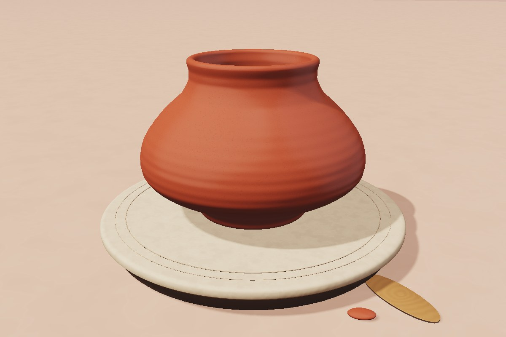</a> <strong>04 · 收一点</strong> 捏口、推腹、查看内腔，把器形带走。 <a href="../public/works/04-pottery/index.html">应用源文件</a> · <a href="../public/works/04-pottery/readme.txt">使用说明</a></td>
</tr>
<tr>
<td width="50%"> <strong>05 · 一个原子的四周</strong> 从外部晶格走到中心原子，理解近邻与边界。 <a href="../public/works/05-crystal/index.html">应用源文件</a> · <a href="../public/works/05-crystal/readme.txt">使用说明</a></td>
<td width="50%"><a href="images/06-optics.jpg">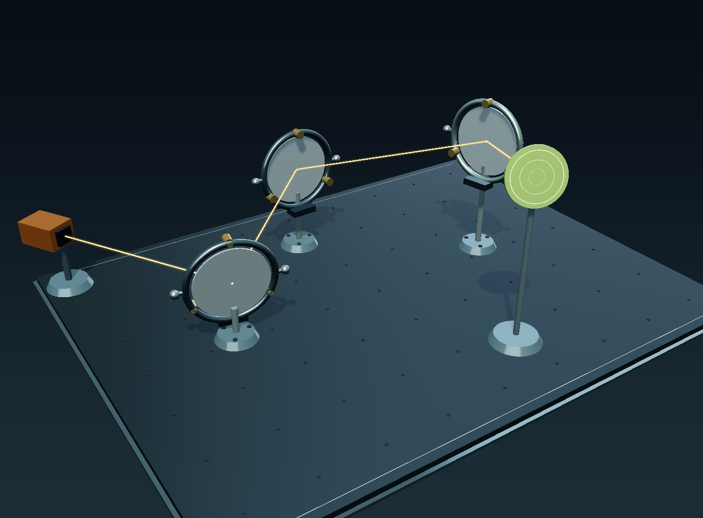</a> <strong>06 · 把光送过去</strong> 调整有限圆镜，让真实反射光线抵达靶面。 <a href="../public/works/06-optics/index.html">应用源文件</a> · <a href="../public/works/06-optics/readme.txt">使用说明</a></td>
</tr>
<tr>
<td width="50%"><a href="images/07-crossing.jpg">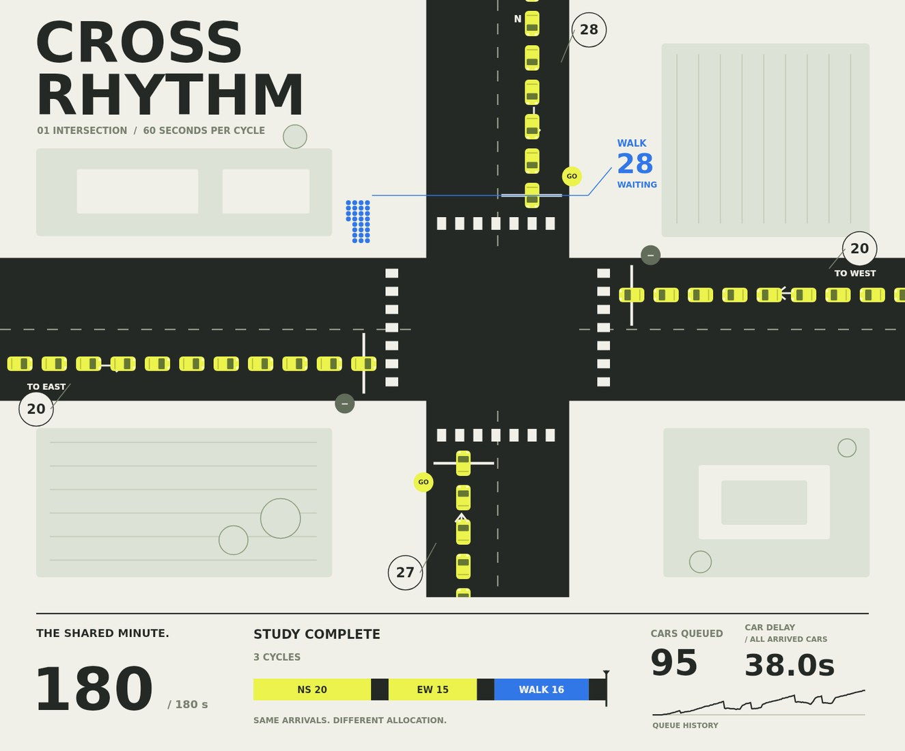</a> <strong>07 · 路口的节拍</strong> 改变绿灯份额，用相同到达流比较等待代价。 <a href="../public/works/07-crossing/index.html">应用源文件</a> · <a href="../public/works/07-crossing/readme.txt">使用说明</a></td>
<td width="50%"> <strong>08 · 字有天气</strong> 把手势变成风，编辑并导出自己的动态字形海报。 <a href="../public/works/08-typewind/index.html">应用源文件</a> · <a href="../public/works/08-typewind/readme.txt">使用说明</a></td>
</tr>
<tr>
<td width="50%"><a href="images/09-waterway.jpg">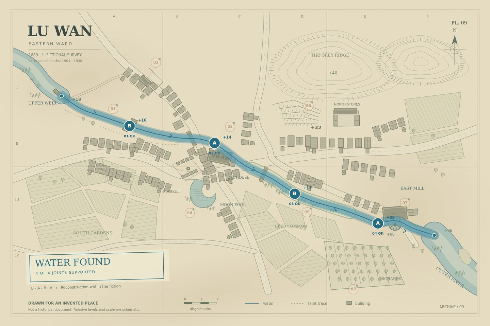</a> <strong>09 · 纸下水声</strong> 勘读八处虚构档案，用证据拼回一条旧水道。 <a href="../public/works/09-waterway/index.html">应用源文件</a> · <a href="../public/works/09-waterway/readme.txt">使用说明</a></td>
<td width="50%"><a href="images/10-tidewalk.jpg">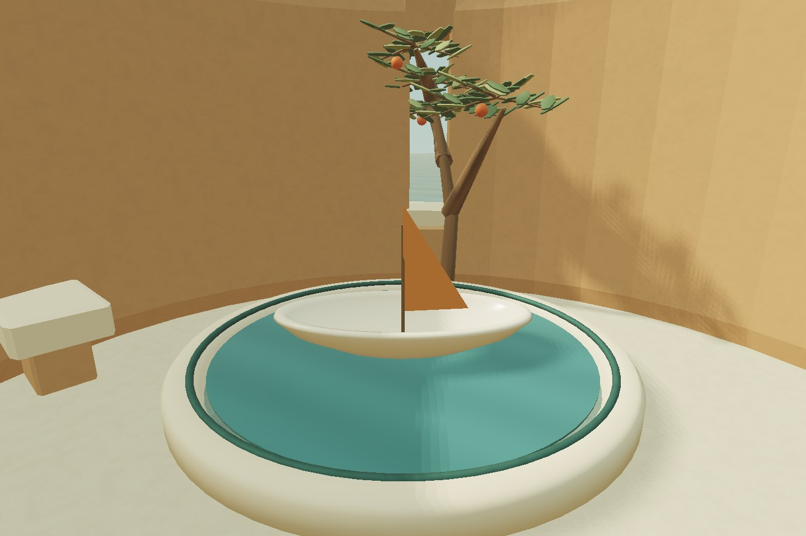</a> <strong>10 · 墙背后的小海</strong> 沿石路穿过拱门与小院，亲自走进去，再从原路回来。 <a href="../public/works/10-tidewalk/index.html">应用源文件</a> · <a href="../public/works/10-tidewalk/readme.txt">使用说明</a></td>
</tr>
</table>

## 实用工坊
<table>
<tr>
<td width="50%"><a href="images/11-store.jpg">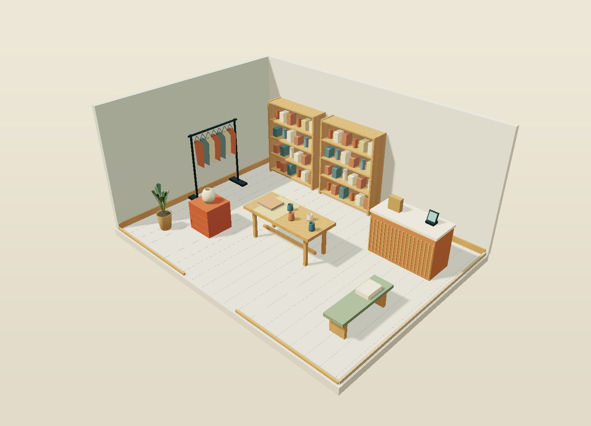</a> <strong>11 · 开店之前</strong> 用真实尺寸布置小店，检查位置冲突并汇总采购。 <a href="../public/works/11-popup/index.html">应用源文件</a> · <a href="../public/works/11-popup/readme.txt">使用说明</a></td>
<td width="50%"> <strong>12 · 折成一份心意</strong> 输入礼物尺寸，折起礼盒并导出毫米尺寸纸样。 <a href="../public/works/12-packaging/index.html">应用源文件</a> · <a href="../public/works/12-packaging/readme.txt">使用说明</a></td>
</tr>
<tr>
<td width="50%"><a href="images/13-shelf.jpg">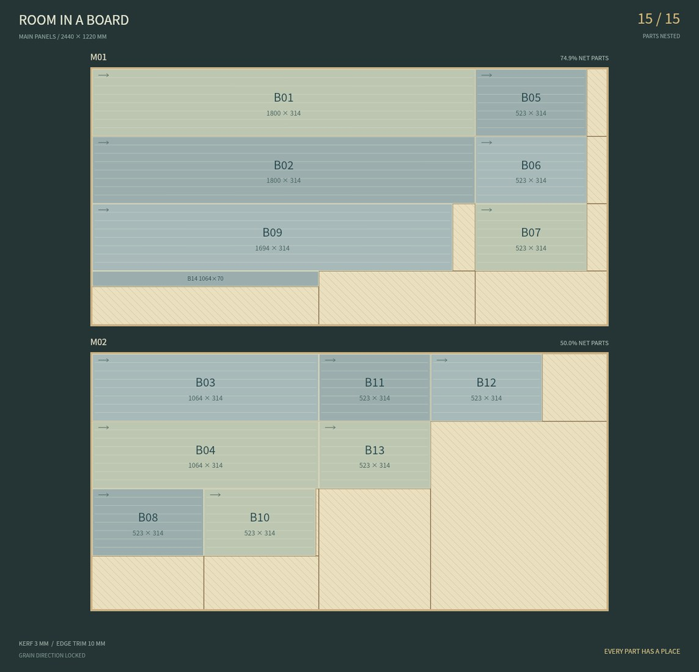</a> <strong>13 · 一块板的余地</strong> 设计书架、展开板件，考虑锯缝与木纹生成下料单。 <a href="../public/works/13-cutlist/index.html">应用源文件</a> · <a href="../public/works/13-cutlist/readme.txt">使用说明</a></td>
<td width="50%"> <strong>14 · 阳台的一季</strong> 布置种植箱、核算土量与株数，导出养护日历。 <a href="../public/works/14-garden/index.html">应用源文件</a> · <a href="../public/works/14-garden/readme.txt">使用说明</a></td>
</tr>
<tr>
<td width="50%"><a href="images/15-dinner.jpg">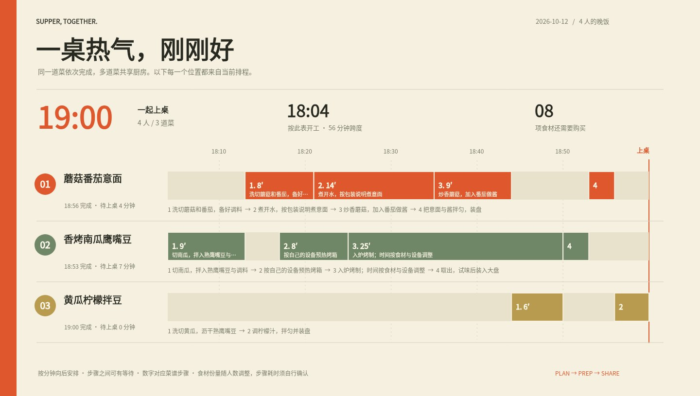</a> <strong>15 · 今晚一起开饭</strong> 从上桌时间倒排动作，把人手、设备和购物一起安排。 <a href="../public/works/15-mealprep/index.html">应用源文件</a> · <a href="../public/works/15-mealprep/readme.txt">使用说明</a></td>
<td width="50%"><a href="images/16-lesson.jpg">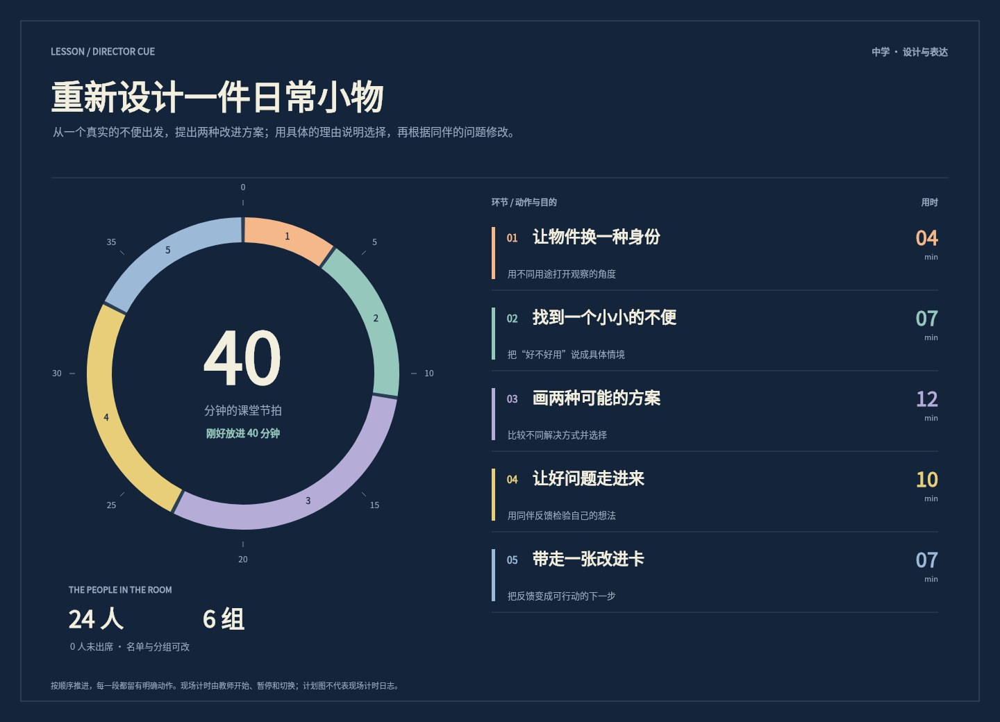</a> <strong>16 · 一堂课的导演</strong> 编排教案、控制现场计时、处理名单与分组。 <a href="../public/works/16-lesson/index.html">应用源文件</a> · <a href="../public/works/16-lesson/readme.txt">使用说明</a></td>
</tr>
</table>

## 科学工作台
<table>
<tr>
<td width="50%"><a href="images/21-fit.jpg">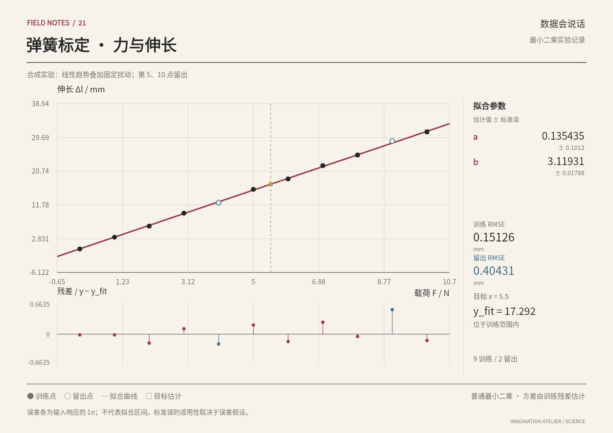</a> <strong>21 · 数据会说话</strong> 导入自己的 CSV，比较拟合、残差与独立留出误差。 <a href="../public/works/21-fit/index.html">应用源文件</a> · <a href="../public/works/21-fit/readme.txt">使用说明</a></td>
<td width="50%"><a href="images/22-optimization.jpg">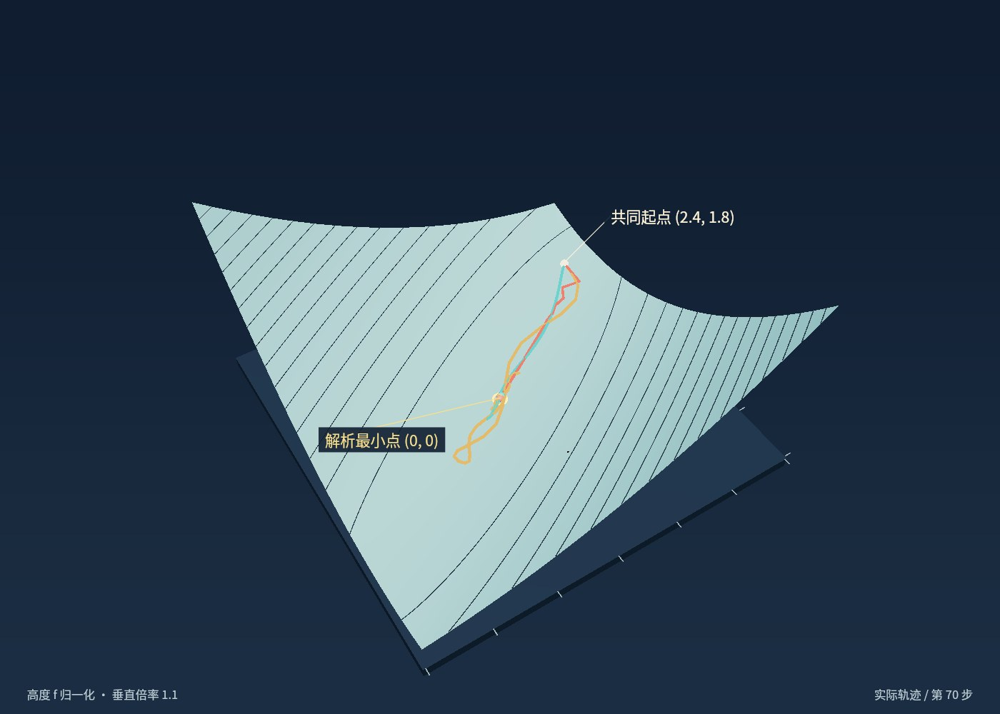</a> <strong>22 · 曲面的下一步</strong> 比较梯度下降、动量与 Adam，观察曲面上的真实迭代。 <a href="../public/works/22-optimization/index.html">应用源文件</a> · <a href="../public/works/22-optimization/readme.txt">使用说明</a></td>
</tr>
<tr>
<td width="50%"><a href="images/23-orbit.jpg">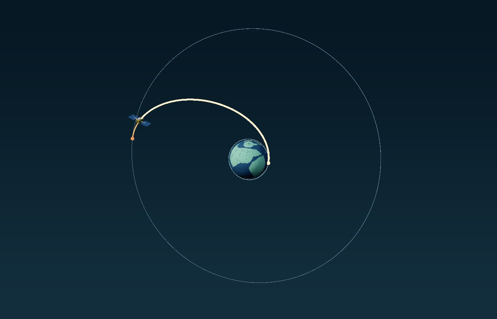</a> <strong>23 · 轨道窗口</strong> 计算理想霍曼转移，让位置随计算时间而变化。 <a href="../public/works/23-orbit/index.html">应用源文件</a> · <a href="../public/works/23-orbit/readme.txt">使用说明</a></td>
<td width="50%"><a href="images/24-circuit.jpg">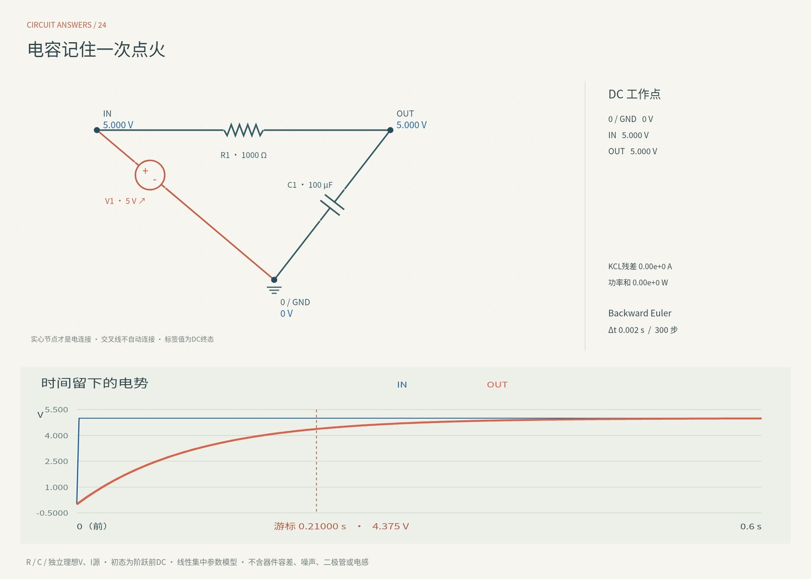</a> <strong>24 · 让电路自己回答</strong> 编辑元件与节点，计算直流和 RC 暂态并输出结果。 <a href="../public/works/24-circuit/index.html">应用源文件</a> · <a href="../public/works/24-circuit/readme.txt">使用说明</a></td>
</tr>
<tr>
<td width="50%"><a href="images/25-watershed.jpg">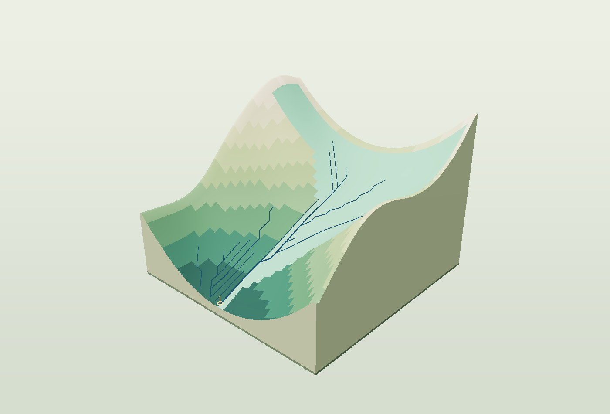</a> <strong>25 · 一滴雨的去向</strong> 导入高度格网，查看流向、汇水范围和雨量体积估算。 <a href="../public/works/25-watershed/index.html">应用源文件</a> · <a href="../public/works/25-watershed/readme.txt">使用说明</a></td>
<td width="50%"><a href="images/26-globe.jpg">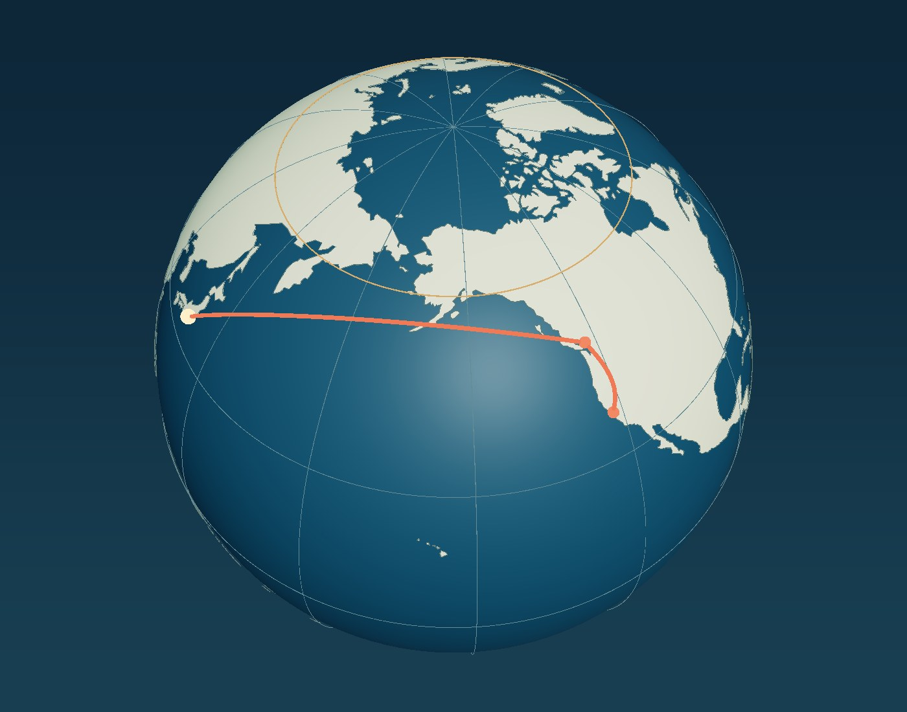</a> <strong>26 · 把地球摊开</strong> 在球面与平面间对照路线、距离和投影变形。 <a href="../public/works/26-globe/index.html">应用源文件</a> · <a href="../public/works/26-globe/readme.txt">使用说明</a></td>
</tr>
<tr>
<td width="50%"><a href="images/27-network.jpg">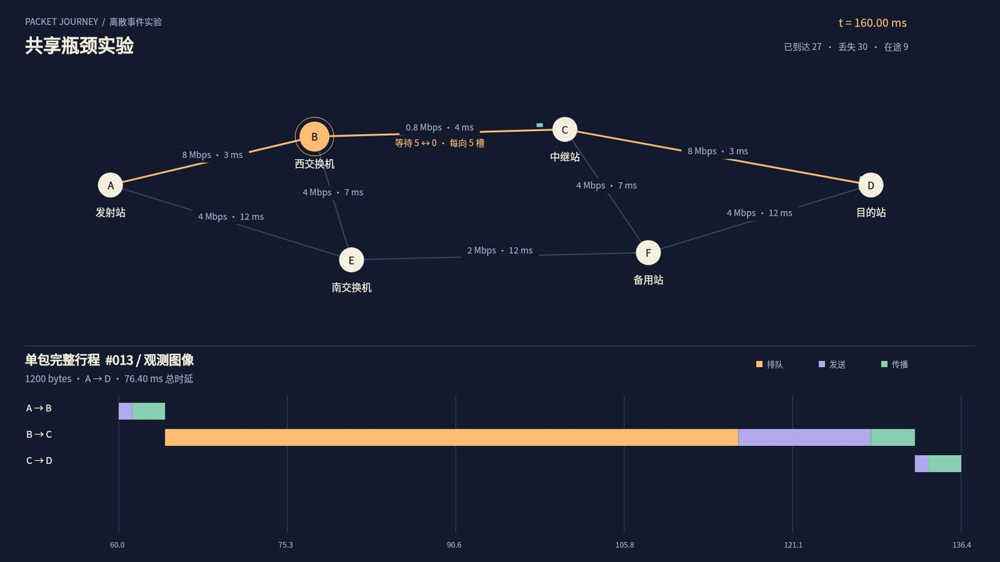</a> <strong>27 · 一封数据包的旅程</strong> 搭建拓扑，改变带宽与队列，追踪包的等待、转发和丢失。 <a href="../public/works/27-network/index.html">应用源文件</a> · <a href="../public/works/27-network/readme.txt">使用说明</a></td>
<td width="50%"><a href="images/28-compression.jpg">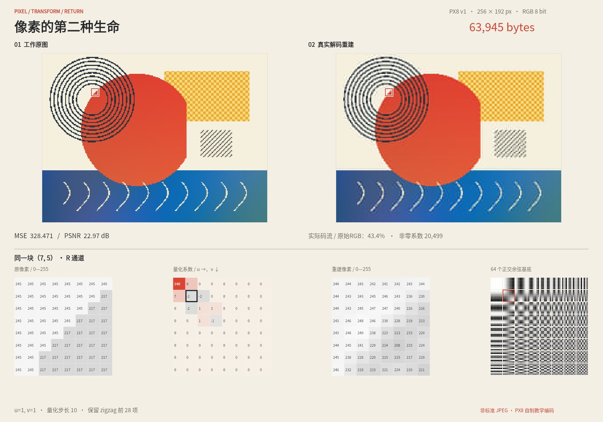</a> <strong>28 · 像素的第二种生命</strong> 导入图片，检查 DCT 与量化，导出并解码 PX8 文件。 <a href="../public/works/28-compression/index.html">应用源文件</a> · <a href="../public/works/28-compression/readme.txt">使用说明</a></td>
</tr>
<tr>
<td width="50%"><a href="images/29-transformer.jpg">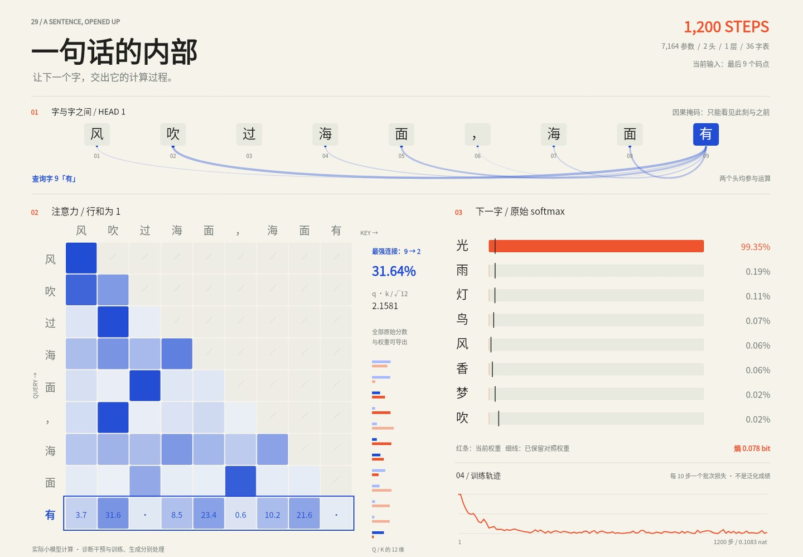</a> <strong>29 · 一句话的内部</strong> 在短语料上训练小型 Transformer，查看注意力并保存训练状态。 <a href="../public/works/29-transformer/index.html">应用源文件</a> · <a href="../public/works/29-transformer/readme.txt">使用说明</a></td>
<td width="50%"><a href="images/30-retrieval.jpg">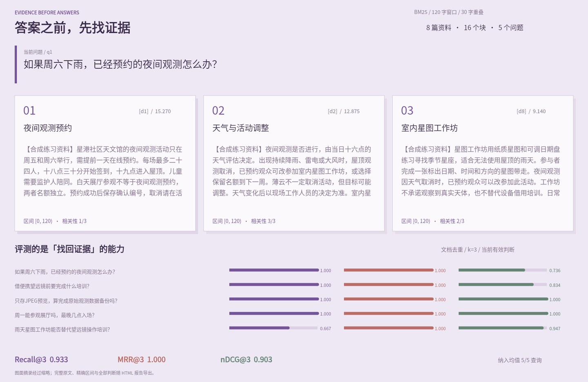</a> <strong>30 · 答案之前，先找证据</strong> 用自己的资料比较 BM25 与 TF-IDF，评测检索并导出证据提示词。 <a href="../public/works/30-rag/index.html">应用源文件</a> · <a href="../public/works/30-rag/readme.txt">使用说明</a></td>
</tr>
</table>