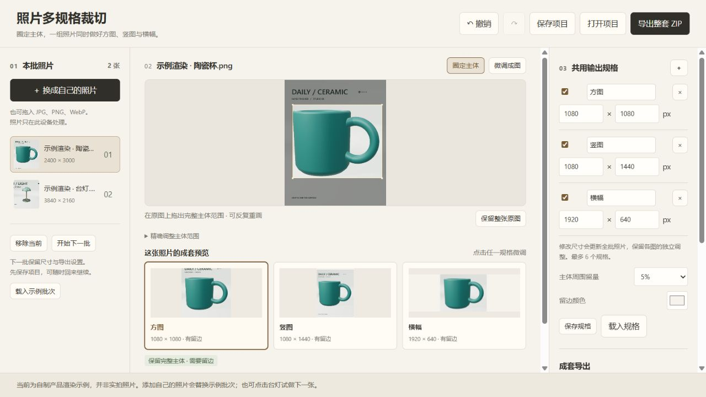
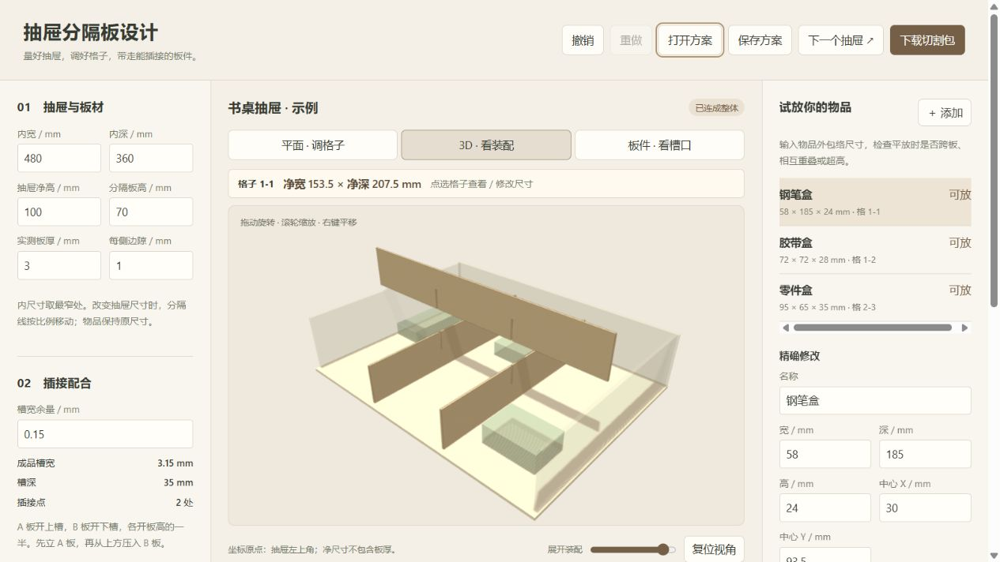
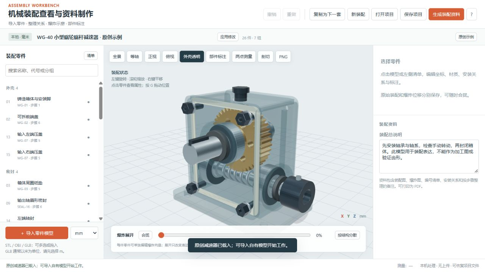
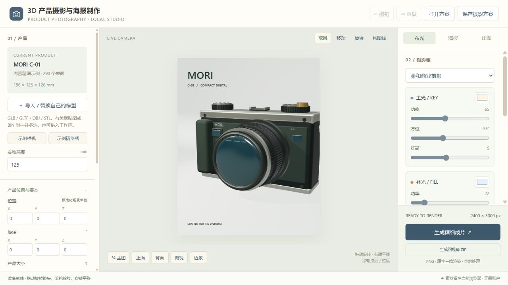
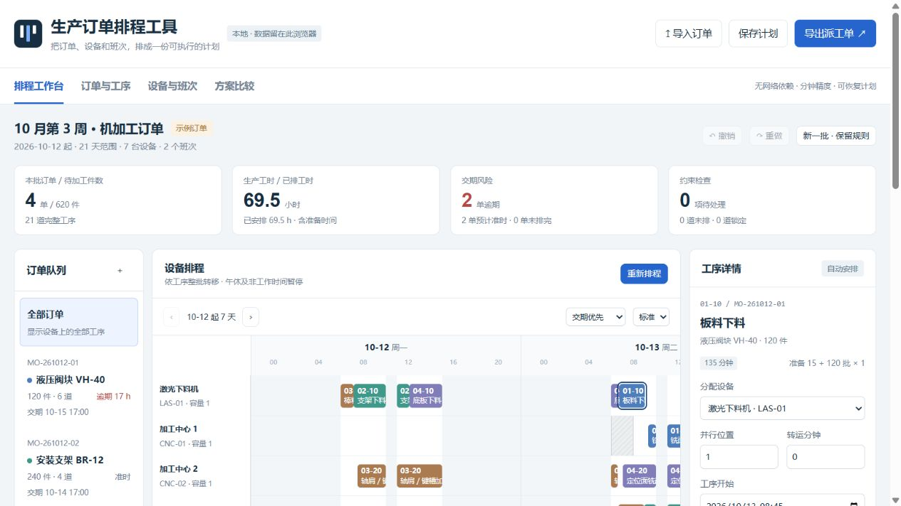
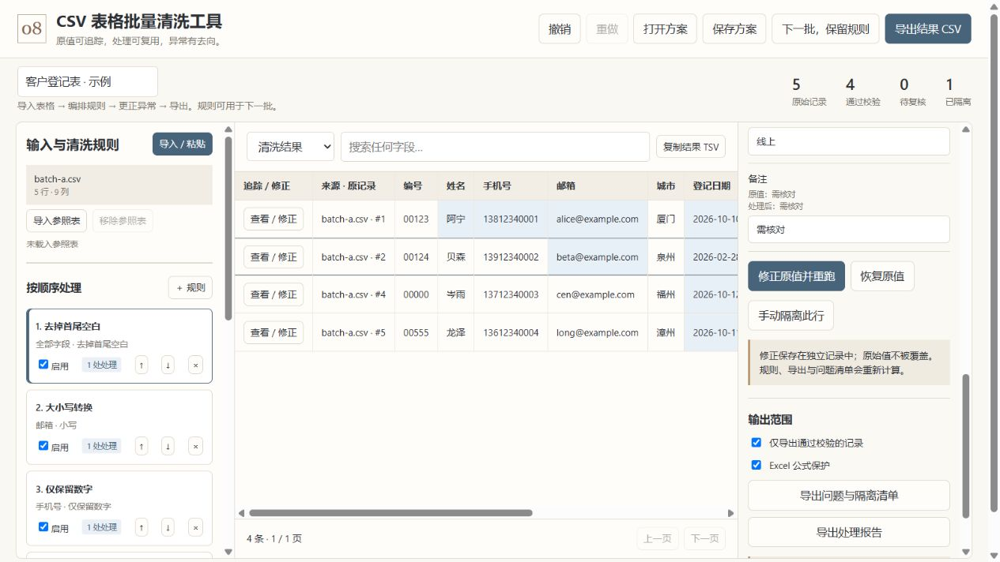
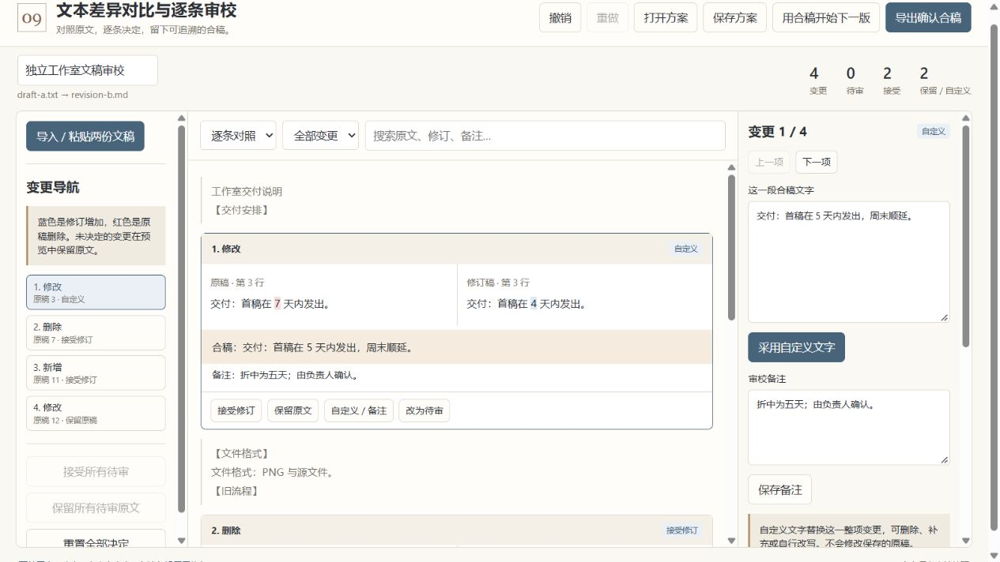
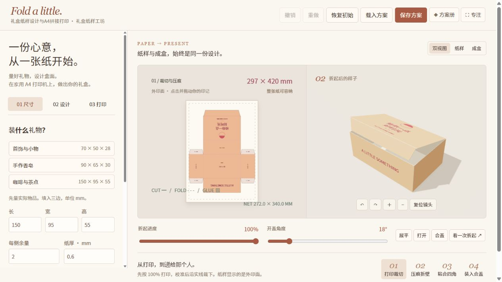

# 实际运行画面

这里展示实际浏览器画面。每件作品的操作、输入格式与验收范围见使用说明和创作记录。

[全部作品](EXAMPLES.md) · [回到 README](../README.md)

## 照片多规格裁切

圈定主体，联动生成多种比例，逐图微调并成套导出；换下一批沿用规格。

[打开作品](../public/works/03-photo-batch/index.html) · [使用说明](../public/works/03-photo-batch/readme.txt)

## 抽屉分隔板设计

调整净格与板厚，联动插接槽口和装配，检查物品适配，导出1:1切割图与板件清单。

[打开作品](../public/works/05-drawer/index.html) · [使用说明](../public/works/05-drawer/readme.txt)

## 机械装配与爆炸图编辑器

导入自己的零件，编辑装配关系、爆炸向量与拆装步骤，输出资料图、零件清单和说明。

[打开作品](../public/works/01-assembly/index.html) · [使用说明](../public/works/01-assembly/readme.txt)

## 3D产品摄影与海报制作

导入商品模型与标识，调整材质、布光和镜头，制作高分辨率产品照片、海报与多视角图片。

[打开作品](../public/works/10-product-studio/index.html) · [使用说明](../public/works/10-product-studio/readme.txt)

## 生产订单排程工具

带入订单与工艺路线，按设备、班次和前置约束排程，修复冲突、比较交期并导出派工。

[打开作品](../public/works/02-production/index.html) · [使用说明](../public/works/02-production/readme.txt)

## CSV表格批量清洗工具

导入多份 CSV，编排清洗规则，追踪并修正异常，导出结果，复用规则处理下一批。

[打开作品](../public/works/08-csv-cleaner/index.html) · [使用说明](../public/works/08-csv-cleaner/readme.txt)

## 文本差异对比与逐条审校

导入两份文稿，逐条接受、保留或自定义变更，留下审校记录与确认合稿，承接下一版。

[打开作品](../public/works/09-text-compare/index.html) · [使用说明](../public/works/09-text-compare/readme.txt)

## 礼盒纸样设计与A4拼接打印

输入礼物尺寸与自己的图形，预览折盒，生成实际尺寸的 A4 拼接纸样。

[打开作品](../public/works/12-packaging/index.html) · [使用说明](../public/works/12-packaging/readme.txt)
